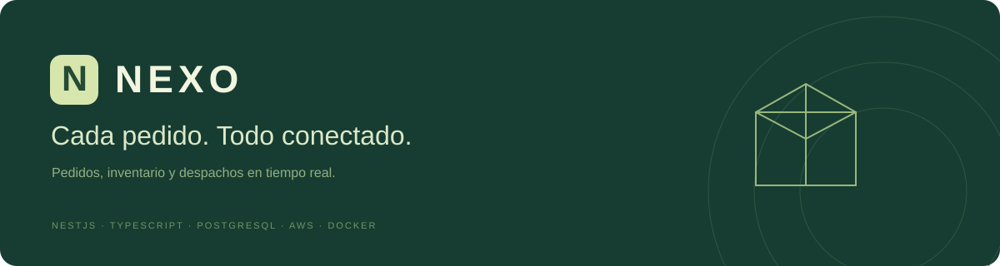
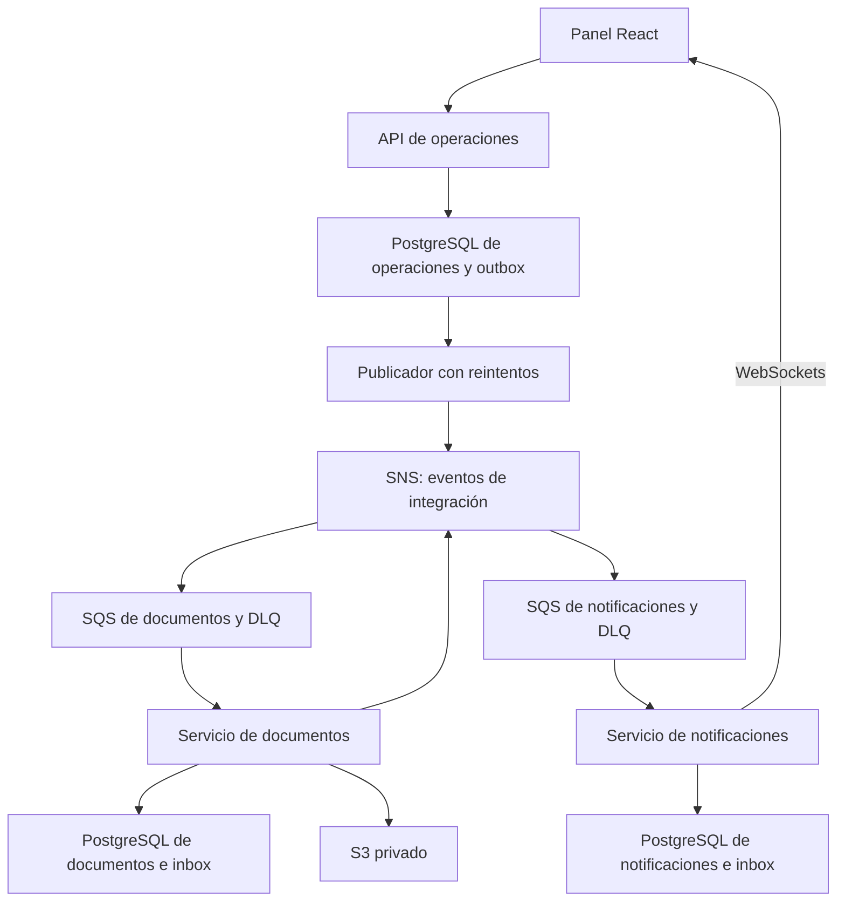

<p align="center"></p>

<p align="center">
  <a href="https://github.com/BryanOnKeys/nexo-fulfillment/actions/workflows/ci.yml"></a>
  
  
  
  
  
</p>

NEXO conecta ventas, almacén y entregas para una distribuidora. Un pedido reserva existencias de forma transaccional, avanza por estados controlados y produce documentos y notificaciones mediante eventos. El panel web está en español y muestra información persistida en las APIs.

**NestJS · TypeScript · MikroORM · PostgreSQL · Docker · DDD · REST · WebSockets · AWS SNS, SQS, S3 y Secrets Manager**

## Ejecutarlo en Windows

Requisitos: **Node.js 24 LTS**, **Git** y **Docker Desktop** con el motor de contenedores Linux iniciado. Los comandos se ejecutan en PowerShell dentro de la carpeta del proyecto.

```powershell
git clone https://github.com/BryanOnKeys/nexo-fulfillment.git
cd nexo-fulfillment
node scripts/setup.mjs
```

Si recibiste el código como ZIP, descomprímelo, abre la carpeta que contiene `package.json` y ejecuta `node scripts/setup.mjs`.

Abre **http://localhost:5173**. El instalador genera `.env`, construye las imágenes, crea tres bases de datos, aplica migraciones y carga datos ficticios. La primera construcción descarga dependencias e imágenes y tarda más que los arranques posteriores.

La contraseña local se genera durante la instalación y se muestra al terminar. También se conserva en `SEED_PASSWORD` dentro de `.env`, archivo excluido de Git.

| Cuenta local         | Permisos                                                                      |
| -------------------- | ----------------------------------------------------------------------------- |
| `admin@nexo.local`   | Administración, catálogo, inventario, pedidos, clientes, usuarios y auditoría |
| `ventas@nexo.local`  | Catálogo, clientes, creación y cancelación de pedidos                         |
| `almacen@nexo.local` | Ajustes de inventario, preparación, despacho y entrega                        |
| `cliente@nexo.local` | Pedidos, documentos y notificaciones de su propia cuenta                      |

Se incluyen **10 clientes, 15 productos y 12 pedidos** en distintos estados. El seed conserva los datos existentes y está bloqueado en producción. Todos los nombres, contactos y operaciones del seed son ficticios.

## Funcionalidades

- Panel de actividad con importes, estados, pedidos recientes y existencias que requieren atención.
- Catálogo de productos con precios en céntimos, categorías y activación o desactivación.
- Inventario físico, unidades reservadas, disponibilidad y movimientos con motivo y responsable.
- Pedidos con múltiples líneas, instantánea de precios, dirección e historial de cambios.
- Control de concurrencia para stock y versiones para modificaciones simultáneas.
- Creación idempotente mediante `Idempotency-Key`.
- Documentos PDF de confirmación y despacho, almacenados en un bucket privado y descargables mediante URLs temporales.
- Notificaciones persistentes y WebSockets autenticados con salas autorizadas por cliente.
- Inicio de sesión, refresh rotatorio en cookie HttpOnly, roles y auditoría.
- Migraciones explícitas, logs estructurados, comprobaciones de salud y CI.

Los documentos son internos de operación; no implementan facturación electrónica ni integración tributaria.

## Arquitectura



| Ubicación                            | Responsabilidad                                                                 |
| ------------------------------------ | ------------------------------------------------------------------------------- |
| `apps/operations/src/domain`         | Dinero, existencias y reglas de transición sin dependencia de NestJS ni del ORM |
| `apps/operations/src/application`    | Casos de uso, comandos y puerto de persistencia de pedidos                      |
| `apps/operations/src/infrastructure` | Adaptación de MikroORM, entidades de persistencia y bloqueos                    |
| `apps/*/src/presentation`            | Controladores HTTP y gateway de WebSockets                                      |
| `apps/documents`                     | Consumo de eventos, generación de PDF y almacenamiento                          |
| `apps/notifications`                 | Bandeja persistente, lecturas por usuario y distribución en tiempo real         |
| `apps/web`                           | Panel React, TypeScript y Vite                                                  |
| `packages/contracts`                 | Contratos versionados de eventos y claims                                       |
| `packages/platform`                  | Configuración, seguridad HTTP, outbox e integración con AWS                     |
| `infra`                              | Docker, proxy y recursos AWS en Terraform                                       |
| `test`                               | Pruebas de dominio e integración entre servicios                                |

Cada servicio es dueño de su base de datos y de sus migraciones. Los servicios intercambian contratos de eventos; no consultan las tablas de otro servicio. El bootstrap local y el proceso de migración son herramientas administrativas, no tráfico de negocio.

## Consistencia que se puede demostrar

| Situación                                 | Comportamiento                                                                |
| ----------------------------------------- | ----------------------------------------------------------------------------- |
| Dos pedidos compiten por la última unidad | El bloqueo de fila permite reservarla una sola vez                            |
| Se reenvía la misma petición              | La clave idempotente devuelve el mismo pedido sin repetir la reserva          |
| Se reutiliza la clave con otro contenido  | Se responde `409 IDEMPOTENCY_CONFLICT`                                        |
| Dos personas cambian un pedido            | La versión antigua recibe `409 STALE_ORDER`                                   |
| Se cancela antes del despacho             | Se libera la reserva y se registra el cambio                                  |
| El publicador no consigue enviar a SNS    | El evento queda pendiente y se reintenta con espera creciente                 |
| Se recibe un evento duplicado             | La inbox evita repetir los efectos de base de datos                           |
| Se corta el WebSocket                     | El panel vuelve a consultar las APIs; las notificaciones permanecen guardadas |

La entrega de eventos es **al menos una vez**. La idempotencia se aplica a cada consumidor; el sistema no afirma entrega global exactamente una vez.

## Desarrollo y pruebas

Para editar desde Windows con PostgreSQL y el emulador AWS en Docker:

```powershell
npm ci
node scripts/setup.mjs --env-only
docker compose up -d postgres moto
npm run build:server
npm run infra:bootstrap
npm run db:migrate
npm run db:seed
npm run dev
```

Si la aplicación completa ya estaba ejecutándose en Docker, detén sus procesos antes de usar los mismos puertos desde Node:

```powershell
docker compose stop web operations documents notifications
```

Validación de código y pruebas unitarias:

```powershell
npm run verify
npm run format:check
```

Pruebas de integración, con las bases y los recursos locales previamente inicializados:

```powershell
$env:NODE_ENV = "test"
npm run test:integration
Remove-Item Env:NODE_ENV
```

Las pruebas de integración crean registros de prueba. Utiliza un entorno local dedicado; la suite exige `NODE_ENV=test`. CI usa PostgreSQL 17 y Moto en contenedores separados.

| Acceso                    | Dirección local                   |
| ------------------------- | --------------------------------- |
| Panel                     | http://localhost:5173             |
| OpenAPI de operaciones    | http://localhost:3001/docs        |
| OpenAPI de documentos     | http://localhost:3002/docs        |
| OpenAPI de notificaciones | http://localhost:3003/docs        |
| Salud de cada servicio    | `/health` y `/ready` en su puerto |

## Documentación del proyecto

- [Decisiones y límites de arquitectura](docs/arquitectura.md)
- [API y ejemplos para PowerShell](docs/api.md)
- [Seguridad y permisos](docs/seguridad.md)
- [Operación, logs y recuperación](docs/operacion.md)
- [Configuración AWS y Terraform](docs/aws.md)
- [Validación y alcance comprobado](docs/validacion.md)
- [Recorrido para presentar el proyecto](docs/presentacion.md)
- [Contribuir mediante cambios pequeños](CONTRIBUTING.md)
- [Reglas para herramientas de IA](AGENTS.md)

## Alcance del despliegue

Docker Compose proporciona el entorno local completo. Moto emula los servicios AWS para desarrollo; no sustituye una prueba de aceptación en una cuenta AWS real. Terraform declara SNS, colas y DLQ, S3 privado, secretos, roles IAM y alarmas; los valores de los secretos se cargan fuera de Terraform.

Para desplegar con usuarios reales se necesitan dominio y HTTPS, PostgreSQL con TLS y copias de seguridad, roles de ejecución, secretos propios y validación del entorno de destino. El servicio de notificaciones utiliza una réplica de WebSockets; la distribución entre varias réplicas requiere un adaptador compartido, explicado en las decisiones de arquitectura.

## Licencia

[MIT](LICENSE) · BryanOnKeys
